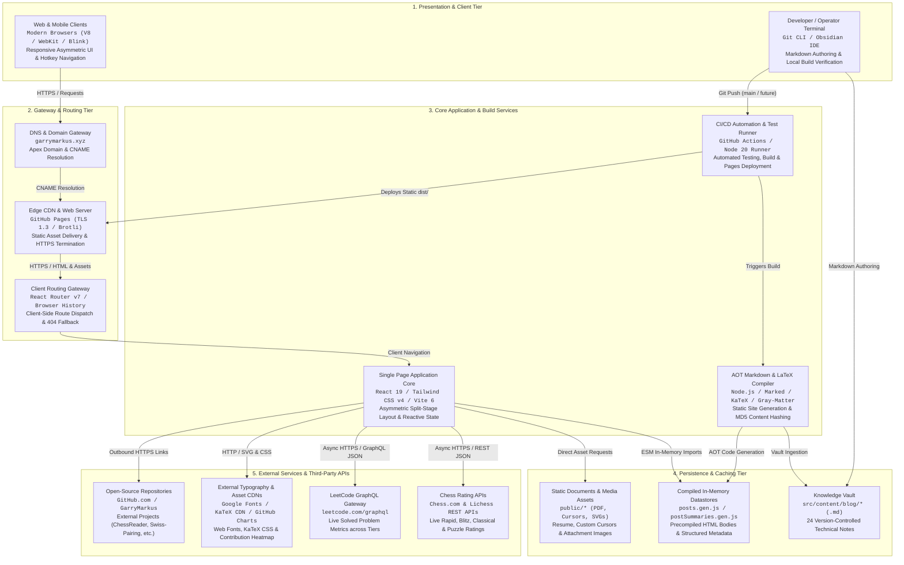

# System Architecture & Technical Specifications

This document provides the exhaustive architectural specification of the **garrymarkus.xyz** platform. It details the high-level system context, the detailed infrastructure architecture, object-oriented system design (OOSD), component hierarchies, data persistence models, build pipelines, and end-to-end data flow lifecycles.

---

## 1. High-Level System Overview

The high-level architecture diagram below conveys the overarching topology of **garrymarkus.xyz** in under two minutes. Following the C4 Container model, it groups the platform into five clean conceptual tiers: Presentation Clients, Gateway & Routing, Core Application & Build Services, Persistence & Static Data Stores, and External Integrations.



### Executive Architectural Summary

The **garrymarkus.xyz** platform implements an ultra-lean, **zero-runtime-backend JAMstack architecture** (JavaScript, APIs, Markup) centered on **Ahead-of-Time (AOT) static compilation and edge delivery**. Rather than relying on traditional monolithic web servers, microservice clusters, or persistent relational database runtimes, all publication content, KaTeX mathematical typesetting, and code syntax tokenization are pre-evaluated at build time. The resulting production artifact is an entirely static, deterministic Single Page Application (SPA) delivered through globally distributed Content Delivery Network (CDN) edge nodes, yielding sub-100ms first contentful paint (FCP) and eliminating server maintenance overhead, database connection bottlenecks, and server-side attack surfaces.

When a user accesses the platform, the apex domain DNS routes incoming traffic to GitHub Pages edge servers, which terminate TLS 1.3 and serve the immutable static bundle (`index.html`, vendor-chunked JavaScript, and CSS). A custom Vite 404 fallback generator (`copy-404-html`) guarantees seamless client-side routing on hard refreshes or deep links by mirroring the root entry point to `404.html`. Upon client hydration, the React 19 engine instantiates an asymmetric split-screen layout: a sticky anchor sidebar providing hotkey-driven keyboard navigation (`1`–`4`, `Escape`), coupled with a dynamic stage container that reacts to route updates. Heavy technical publications and project catalogues are loaded directly into memory from pre-compiled static stores, allowing instantaneous transitions with zero network latency.

The technology choices prioritize deterministic execution, type safety, minimal bundle overhead, and first-principles systems ergonomics. **React 19** and **Tailwind CSS v4** power the presentation layer without legacy PostCSS wrappers, utilizing modern CSS `@theme` tokens and snappy hardware-accelerated animations. The offline compilation pipeline leverages **Node.js**, **Marked**, **Marked-KaTeX-Extension**, and **Highlight.js** to compile Obsidian markdown vaults into static modules while preserving creation timestamps through MD5 content checksums. For live verified performance benchmarks, the client asynchronously queries public REST and GraphQL APIs (Chess.com, Lichess, LeetCode, GitHub) directly from the browser, incorporating defensive fallbacks to ensure full offline and rate-limited resilience.

---

## 2. Detailed Unified Architecture Canvas

The entire platform is exhaustively mapped below within a single, unified Mermaid flowchart. It encapsulates:
1. **System & Infrastructure Architecture**: Client runtime, CDN edge hosting, gateway routing, build runners, data persistence, and external APIs.
2. **Object-Oriented System Design (OOSD) & Core Components**: Domain entities, repositories, controllers, view handlers, and explicit structural relationships.
3. **Data Flow & State Management**: Static compilation lifecycles, client SPA hydration, telemetry ingestion, search/filter engines, and DOM manipulation.

```mermaid
flowchart TB
%% ============================================================================
%% SUBGRAPH 1: SYSTEM & INFRASTRUCTURE ARCHITECTURE
%% ============================================================================
    subgraph INFRA ["System & Infrastructure Architecture"]
        subgraph CLIENT_TIER ["Client Applications & Presentation Tier"]
            CLIENT_BROWSER["Web Client (Desktop / Mobile Browser)<br/><code>User Agent: V8 / WebKit / Blink</code><br/>Executes React 19 SPA, handles DOM mutations"]
            CLIENT_INDEX["SPA Host Document Entry Point<br/><code>index.html</code><br/>HTML5 Shell, Root DOM Container, Preconnect CDN Links"]
            CLIENT_CSS["Tailwind CSS v4 Engine & Design System<br/><code>src/index.css</code><br/>Color tokens, typography fonts, custom cursor mappings, .prose styling"]
            CLIENT_CURSORS["Custom OS Bitmap Cursor Assets<br/><code>public/cursors/*</code><br/>default.png (0,0), pointer.png (7,5), text.png (12,12), crosshair.png"]
            CLIENT_FONTS["Google Fonts Typography CDN<br/><code>fonts.googleapis.com</code><br/>Courier Prime, Inter, JetBrains Mono, Space Grotesk, Space Mono"]
            CLIENT_KATEX_CSS["KaTeX Distribution CDN<br/><code>cdn.jsdelivr.net/npm/katex@0.17.0</code><br/>KaTeX CSS stylesheets, web font glyphs"]
            CLIENT_STATIC_ASSETS["Static Documents & Brand Assets<br/><code>public/*</code><br/>icon.svg, Prem_Singh_Resume.pdf, brand icons"]
        end

        subgraph GATEWAY_TIER ["Hosting, Routing & Gateway Tier"]
            GW_DNS["Apex Domain & DNS Gateway<br/><code>garrymarkus.xyz</code><br/>Configured via public/CNAME, ALIAS / A records"]
            GW_GH_PAGES["GitHub Pages Edge CDN & Web Server<br/><code>GitHub Pages Infrastructure</code><br/>HTTPS TLS termination, .nojekyll bypass, Brotli delivery"]
            GW_SPA_FALLBACK["Vite 404 Fallback Generator Plugin<br/><code>vite.config.js (copy-404-html)</code><br/>Copies index.html to dist/404.html on bundle close for SPA routing"]
            GW_LOCAL_DEV["Vite Local Dev & Preview Servers<br/><code>vite.config.js</code><br/>HMR Dev Server on :3000, Rollup Preview Server on :4173"]
        end

        subgraph BUILD_TIER ["Build, Compilation & CI/CD Pipeline (Task Runners / Queues)"]
            BUILD_GHA["GitHub Actions CI/CD Workflow<br/><code>.github/workflows/deploy.yml</code><br/>Runs on push to main/future; installs Node 20, builds, deploys Pages"]
            BUILD_COMPILER["Obsidian Markdown Compiler Script<br/><code>scripts/compile-posts.js</code><br/>Parses frontmatter, compiles KaTeX math, highlights code, hashes MD5"]
            BUILD_TEST_RUNNER["Preview Verification Test Suite<br/><code>scripts/test-preview.js</code><br/>Spawns vite preview subprocess, validates HTTP 200 OK across routes"]
            BUILD_LINTER["ESLint Flat Configuration Engine<br/><code>eslint.config.mjs</code><br/>Flat ESLint v9 linting across JS/JSX with React plugin rules"]
            BUILD_VITE_CORE["Vite Bundler & Rollup Optimizer<br/><code>vite.config.js</code><br/>@tailwindcss/vite, @vitejs/plugin-react, Rollup manualChunks vendor split"]
        end

        subgraph DATA_TIER ["Data Persistence & Static Stores"]
            DATA_VAULT["Obsidian Knowledge Vault (Markdown Sources)<br/><code>src/content/blog/*</code><br/>24 Markdown notes across CyberSecurity, DSA, Go, Numpy"]
            DATA_POSTS_GEN["Compiled In-Memory Post Store<br/><code>src/lib/posts.gen.js</code><br/>Full dataset with parsed HTML bodies, categories, tags, MD5 hashes"]
            DATA_SUMMARIES_GEN["Lightweight Post Summaries Store<br/><code>src/lib/postSummaries.gen.js</code><br/>Stripped metadata store for high-performance overview/list views"]
            DATA_PROJECTS["Audited Systems Dataset<br/><code>src/data/projects.js</code><br/>10 detailed project dossiers, constraints, stats, categories"]
        end

        subgraph EXT_TIER ["Third-Party External Services & Telemetry APIs"]
            EXT_CHESS["Chess.com Public REST API<br/><code>api.chess.com/pub/player/garrymarkus/stats</code><br/>Rapid, Blitz, and Bullet rating records"]
            EXT_LICHESS["Lichess Open REST API<br/><code>lichess.org/api/user/garrymarkus</code><br/>Classical, Rapid, Blitz, and Puzzle performance ratings"]
            EXT_LEETCODE["LeetCode Public GraphQL Gateway<br/><code>leetcode.com/graphql</code><br/>Matched user problem submission counts across Easy, Medium, Hard tiers"]
            EXT_HEATMAP["GitHub Contributions Stream<br/><code>ghchart.rshah.org/3b82f6/GarryMarkus</code><br/>SVG activity heatmap with custom color grading"]
            EXT_KOMAREV["Komarev Profile Counter<br/><code>komarev.com/ghpvc</code><br/>README profile view badge tracking"]
            EXT_REPOS["External Project Repositories<br/><code>github.com/GarryMarkus/*</code><br/>ChessReader, Document-Viewer, Swiss-Pairing, Skip-The-Scroll, etc."]
        end
    end

%% ============================================================================
%% SUBGRAPH 2: OBJECT-ORIENTED SYSTEM DESIGN (OOSD) & CORE COMPONENTS
%% ============================================================================
    subgraph OOSD ["Object-Oriented System Design (OOSD) & Core Components"]
        subgraph ENTITIES_TIER ["Core Domain Entities & Data Models"]
            ENTITY_POST["PostEntity<br/><code>src/lib/posts.gen.js</code><br/>slug, title, date, rawDate, readTime, excerpt, tags, category, contentHtml, _hash"]
            ENTITY_SUMMARY["PostSummaryEntity<br/><code>src/lib/postSummaries.gen.js</code><br/>slug, title, date, rawDate, readTime, excerpt, tags, category"]
            ENTITY_PROJECT["ProjectEntity<br/><code>src/data/projects.js</code><br/>id, title, tagline, category, year, problem, architecture, constraints, highlights, stack, stats"]
            ENTITY_EXP["ExperienceEntity<br/><code>src/pages/Experience.jsx</code><br/>id, role, organization, date, isCurrent, category, skills, deliverables"]
            ENTITY_CURRICULUM["CurriculumEntity<br/><code>src/pages/Experience.jsx</code><br/>area, courses[] (Systems, Algorithms, Networks, Engineering)"]
            ENTITY_CAPABILITY["CapabilityEntity<br/><code>src/pages/Experience.jsx</code><br/>domain, spec (Languages, Protocols, Persistence, Toolchains)"]
            ENTITY_TELEMETRY["TelemetryState<br/><code>src/components/TelemetryGrid.jsx</code><br/>chessData, lichessData, lcData, rapid, blitz, lichessClassical, lcStats"]
        end

        subgraph REPO_TIER ["Repositories & Data Access Layer (DAOs)"]
            REPO_POSTS["PostsRepository (Data Access Facade)<br/><code>src/lib/posts.js</code><br/>getAllPosts(), getPostSummaries(), getAllCategories(), getPostBySlug(slug)"]
            REPO_PROJECTS["ProjectsRepository (Static Data Provider)<br/><code>src/data/projects.js</code><br/>projects[], projectCategories[]"]
        end

        subgraph APP_SHELL_TIER ["Application Controllers & Layout Shells"]
            CTRL_ROOT["ApplicationRoot<br/><code>src/main.jsx</code><br/>ReactDOM.createRoot(root).render() with React.StrictMode"]
            CTRL_APP["App / Router Controller<br/><code>src/App.jsx</code><br/>BrowserRouter, Routes, Route, ScrollToTop, Presentation Shell"]
            CTRL_LAYOUT["SplitLayout Shell Component<br/><code>src/components/SplitLayout.jsx</code><br/>Asymmetric 38/62 split frame, sticky sidebar, dynamic Outlet stage"]
            CTRL_ANCHOR["Anchor Navigation Controller<br/><code>src/components/Anchor.jsx</code><br/>Hotkey event listener (1-4, Escape), NavLinks, identity metadata, status tags"]
        end

        subgraph PAGES_TIER ["View Handlers & Page Controllers"]
            PAGE_HOME["Home Page Handler<br/><code>src/pages/Home.jsx</code><br/>Overview stage aggregating Hero, TelemetryGrid, featuredProjects, recentPosts"]
            PAGE_PROJECTS["Projects Page Handler<br/><code>src/pages/Projects.jsx</code><br/>Category filtering, live keyword search, useMemo query matcher"]
            PAGE_BLOG["Blog Page Handler<br/><code>src/pages/Blog.jsx</code><br/>Discipline tabs, keyword search, tabular publications ledger"]
            PAGE_POST["BlogPost Document Handler<br/><code>src/pages/BlogPost.jsx</code><br/>Slug route resolver, reading progress tracker, copy button injector"]
            PAGE_EXP["Experience Page Handler<br/><code>src/pages/Experience.jsx</code><br/>Leadership chronicle, ABESEC CSE curriculum matrix, capability table"]
            PAGE_404["NotFound Exception Handler<br/><code>src/pages/NotFound.jsx</code><br/>Diagnostic 404 recovery stage with verified section routes (01-04)"]
        end

        subgraph COMP_LEAF_TIER ["Presentation Components & UI Modules"]
            COMP_HERO["Hero Component<br/><code>src/components/Hero.jsx</code><br/>Category ribbon, core engineering thesis, domains tag cloud"]
            COMP_TELEMETRY["TelemetryGrid Component<br/><code>src/components/TelemetryGrid.jsx</code><br/>Async fetch manager for Chess.com, Lichess, LeetCode; tabular registers"]
            COMP_DOSSIER["ProjectDossier Component<br/><code>src/components/ProjectDossier.jsx</code><br/>Accordion state (isExpanded), technical specs, constraints ledger"]
        end

        %% Explicit Structural Relationships (OOSD)
        CTRL_LAYOUT -- "Composition (composes pinned sidebar)" --> CTRL_ANCHOR
        CTRL_LAYOUT -- "Composition (composes dynamic stage)" --> PAGES_TIER
        PAGE_HOME -- "Composition (composes hero header)" --> COMP_HERO
        PAGE_HOME -- "Composition (composes telemetry grid)" --> COMP_TELEMETRY
        PAGE_PROJECTS -- "Aggregation (renders project dossiers)" --> COMP_DOSSIER
        ENTITY_SUMMARY -- "Specialization (derived without HTML)" --> ENTITY_POST
        REPO_POSTS -- "Data Access Facade" --> ENTITY_POST
        REPO_POSTS -- "Data Access Facade" --> ENTITY_SUMMARY
        REPO_PROJECTS -- "Data Provider" --> ENTITY_PROJECT
        COMP_DOSSIER -- "Associates with model" --> ENTITY_PROJECT
        PAGE_EXP -- "Associates with models" --> ENTITY_EXP
        PAGE_EXP -- "Associates with models" --> ENTITY_CURRICULUM
        PAGE_EXP -- "Associates with models" --> ENTITY_CAPABILITY
        COMP_TELEMETRY -- "Mutates state" --> ENTITY_TELEMETRY
        CTRL_ANCHOR -- "Event Listener Binding" --> CTRL_APP
    end

%% ============================================================================
%% SUBGRAPH 3: DATA FLOW & STATE MANAGEMENT
%% ============================================================================
    subgraph DATAFLOW ["Data Flow & State Management"]
        subgraph FLOW_SSG ["Static Site Generation & Post Compilation Pipeline (SSG)"]
            FLOW_SSG_1["1. Vault Ingestion<br/>fs.readdirSync reads markdown files in src/content/blog/*"]
            FLOW_SSG_2["2. Frontmatter Extraction<br/>gray-matter parses YAML title, date, slug, tags, excerpt"]
            FLOW_SSG_3["3. Asset Relocation & Syntax Rewrite<br/>Copies attachments; rewrites image paths & ==highlights=="]
            FLOW_SSG_4["4. Markdown & KaTeX Parsing<br/>marked + marked-katex-extension renders HTML + KaTeX math"]
            FLOW_SSG_5["5. Syntax Highlighting<br/>marked-highlight + highlight.js tokenizes code blocks"]
            FLOW_SSG_6["6. Heading Anchor Slugification<br/>marked.Renderer.heading generates collision-safe heading IDs"]
            FLOW_SSG_7["7. MD5 Hashing & Date Persistence<br/>crypto.createHash('md5') preserves original post dates"]
            FLOW_SSG_8["8. Code Artifact Emission<br/>fs.writeFileSync writes posts.gen.js & postSummaries.gen.js"]
        end

        subgraph FLOW_SPA ["Client Boot & Single Page Routing Lifecycle (SPA)"]
            FLOW_SPA_1["1. Initial HTTP Request<br/>Browser requests garrymarkus.xyz/ (or sub-route /projects)"]
            FLOW_SPA_2["2. Edge CDN Delivery<br/>GitHub Pages serves index.html (or 404.html fallback) + assets"]
            FLOW_SPA_3["3. React Hydration & Mount<br/>ReactDOM.createRoot mounts App tree into document #root"]
            FLOW_SPA_4["4. Layout Shell Mount<br/>SplitLayout instantiates sticky Anchor (38%) & main Outlet (62%)"]
            FLOW_SPA_5["5. Hotkey Keyboard Interception<br/>window.onkeydown intercepts keys 1-4 / Escape, calls useNavigate()"]
            FLOW_SPA_6["6. Dynamic Stage Transition<br/>URL pathname updates; triggers 0.15s CSS .animate-stage-enter"]
        end

        subgraph FLOW_TEL ["Asynchronous External Telemetry Ingestion Flow"]
            FLOW_TEL_1["1. Component Mount Hook<br/>TelemetryGrid.jsx triggers useEffect() on initial mount"]
            FLOW_TEL_2["2. Multi-API Fetch Triggers<br/>Dispatches concurrent fetch() requests to external APIs"]
            FLOW_TEL_3["3. Chess.com Ingestion<br/>GET api.chess.com/pub/player/garrymarkus/stats (JSON)"]
            FLOW_TEL_4["4. Lichess Ingestion<br/>GET lichess.org/api/user/garrymarkus (JSON)"]
            FLOW_TEL_5["5. LeetCode GraphQL Ingestion<br/>POST leetcode.com/graphql (JSON GraphQL query)"]
            FLOW_TEL_6["6. Deserialization & Fallbacks<br/>Resolves JSON responses; applies verified fallback ratings if throttled"]
            FLOW_TEL_7["7. Reactive State Re-render<br/>useState setters update chessData, lichessData, lcData; re-renders DOM"]
        end

        subgraph FLOW_SEARCH ["Real-Time Search, Filtering & Memoization Flow"]
            FLOW_SEARCH_1["1. User Interaction Event<br/>User types in search input or clicks category filter button"]
            FLOW_SEARCH_2["2. State Dispatch<br/>Triggers setSearchQuery(query) or setSelectedCategory(category)"]
            FLOW_SEARCH_3["3. Memoized Filter Evaluation<br/>useMemo executes multi-predicate filter across title, problem, stack"]
            FLOW_SEARCH_4["4. Virtual DOM Reconciliation<br/>React reconciles list of ProjectDossier or Blog rows; handles empty state"]
        end

        subgraph FLOW_READER ["Document Reader, Scroll Tracking & DOM Injection Flow"]
            FLOW_READER_1["1. Dynamic Route Resolution<br/>useParams().slug extracts URL slug; calls getPostBySlug(slug)"]
            FLOW_READER_2["2. Reading Progress Computation<br/>window.onscroll evaluates (scrollY / totalHeight) * 100"]
            FLOW_READER_3["3. Hairline Bar DOM Animation<br/>Updates fixed hairline progress bar width (0% to 100%)"]
            FLOW_READER_4["4. Copy Button DOM Synthesis<br/>useEffect + contentRef scans pre blocks, appends copy buttons"]
            FLOW_READER_5["5. Clipboard API Execution<br/>navigator.clipboard.writeText() copies code; flashes 'Copied'"]
        end
    end

%% ============================================================================
%% CROSS-SUBGRAPH FUNCTIONAL INTEGRATION CONNECTIONS
%% ============================================================================

    %% SSG Flow Connections
    DATA_VAULT -->|"Read raw Markdown files"| FLOW_SSG_1
    FLOW_SSG_1 --> FLOW_SSG_2 --> FLOW_SSG_3 --> FLOW_SSG_4 --> FLOW_SSG_5 --> FLOW_SSG_6 --> FLOW_SSG_7 --> FLOW_SSG_8
    FLOW_SSG_8 -->|"Emits full dataset"| DATA_POSTS_GEN
    FLOW_SSG_8 -->|"Emits lightweight summaries"| DATA_SUMMARIES_GEN

    %% Build & CI/CD Connections
    BUILD_GHA -->|"Step 1: npm ci & compile"| BUILD_COMPILER
    BUILD_COMPILER -->|"Executes build job"| FLOW_SSG
    BUILD_GHA -->|"Step 2: npm run build"| BUILD_VITE_CORE
    BUILD_VITE_CORE -->|"Emits static dist/"| GW_GH_PAGES
    BUILD_VITE_CORE -->|"Hook: closeBundle()"| GW_SPA_FALLBACK
    BUILD_GHA -->|"Step 3: npm test"| BUILD_TEST_RUNNER
    BUILD_TEST_RUNNER -->|"Spawns preview server"| GW_LOCAL_DEV

    %% SPA Client Boot Connections
    CLIENT_BROWSER -->|"HTTPS GET /"| GW_DNS
    GW_DNS -->|"Resolves CNAME"| GW_GH_PAGES
    GW_GH_PAGES -->|"Serves index.html + hashed JS/CSS"| FLOW_SPA_1
    FLOW_SPA_1 --> FLOW_SPA_2 --> FLOW_SPA_3
    FLOW_SPA_3 -->|"Mounts root tree"| CTRL_ROOT
    CTRL_ROOT -->|"Renders app"| CTRL_APP
    CTRL_APP -->|"Renders layout"| CTRL_LAYOUT
    CTRL_LAYOUT -->|"Composes left sidebar"| CTRL_ANCHOR
    CTRL_LAYOUT -->|"Composes right stage"| FLOW_SPA_4
    CTRL_ANCHOR -->|"Binds keydown listener"| FLOW_SPA_5
    FLOW_SPA_5 -->|"useNavigate() trigger"| FLOW_SPA_6

    %% Repositories & Data Injection
    DATA_POSTS_GEN -->|"ESM Named Import"| REPO_POSTS
    DATA_SUMMARIES_GEN -->|"ESM Named Import"| REPO_POSTS
    DATA_PROJECTS -->|"ESM Named Import"| REPO_PROJECTS

    REPO_POSTS -->|"Dependency Injection: getPostSummaries()"| PAGE_HOME
    REPO_POSTS -->|"Dependency Injection: getPostSummaries()"| PAGE_BLOG
    REPO_POSTS -->|"Dependency Injection: getPostBySlug()"| PAGE_POST
    REPO_PROJECTS -->|"Dependency Injection: projects, categories"| PAGE_PROJECTS

    %% Component Composition (OOSD)
    CTRL_LAYOUT -->|"Dynamic Route Outlet"| PAGE_HOME
    CTRL_LAYOUT -->|"Dynamic Route Outlet"| PAGE_PROJECTS
    CTRL_LAYOUT -->|"Dynamic Route Outlet"| PAGE_BLOG
    CTRL_LAYOUT -->|"Dynamic Route Outlet"| PAGE_POST
    CTRL_LAYOUT -->|"Dynamic Route Outlet"| PAGE_EXP
    CTRL_LAYOUT -->|"Dynamic Route Outlet"| PAGE_404

    PAGE_HOME -->|"Composes header"| COMP_HERO
    PAGE_HOME -->|"Composes telemetry"| COMP_TELEMETRY
    PAGE_PROJECTS -->|"Composes cards"| COMP_DOSSIER

    %% Telemetry Live Flow
    COMP_TELEMETRY -->|"Mounts component"| FLOW_TEL_1
    FLOW_TEL_1 --> FLOW_TEL_2
    FLOW_TEL_2 -->|"Async GET"| FLOW_TEL_3 -->|"REST JSON"| EXT_CHESS
    FLOW_TEL_2 -->|"Async GET"| FLOW_TEL_4 -->|"REST JSON"| EXT_LICHESS
    FLOW_TEL_2 -->|"Async POST"| FLOW_TEL_5 -->|"GraphQL JSON"| EXT_LEETCODE
    EXT_CHESS -->|"Ratings JSON"| FLOW_TEL_6
    EXT_LICHESS -->|"Ratings JSON"| FLOW_TEL_6
    EXT_LEETCODE -->|"Solved stats JSON"| FLOW_TEL_6
    FLOW_TEL_6 --> FLOW_TEL_7
    FLOW_TEL_7 -->|"Mutates React State"| ENTITY_TELEMETRY

    %% Search & Filter Flow
    PAGE_PROJECTS -->|"onChange event"| FLOW_SEARCH_1
    PAGE_BLOG -->|"onChange event"| FLOW_SEARCH_1
    FLOW_SEARCH_1 --> FLOW_SEARCH_2 --> FLOW_SEARCH_3 --> FLOW_SEARCH_4

    %% Reader Flow
    PAGE_POST -->|"Mounts route /blog/:slug"| FLOW_READER_1
    FLOW_READER_1 --> FLOW_READER_2 --> FLOW_READER_3
    FLOW_READER_1 --> FLOW_READER_4 --> FLOW_READER_5

    %% Static Assets & CDNs
    CLIENT_INDEX -->|"Preconnects"| CLIENT_FONTS
    CLIENT_INDEX -->|"Links KaTeX CSS"| CLIENT_KATEX_CSS
    CLIENT_CSS -->|"Binds cursor URLs"| CLIENT_CURSORS
```

---

## 3. System & Infrastructure Architecture

The platform architecture follows an ultra-clean, **zero-runtime-backend** philosophy. All dynamic rendering, cryptographic hashing, and markdown tokenization are completed ahead-of-time (AOT) during the offline compilation phase, resulting in a 100% static client delivery that requires zero servers, database processes, or container clusters at runtime.

### 3.1 Client Application & Asset Delivery Layer
- **SPA Host Document (`index.html`)**: The root HTML5 container (`<div id="root"></div>`) that configures preconnect headers for Google Fonts, links external KaTeX CDN stylesheets, and defines strict OpenGraph and Twitter card metadata for SEO indexing.
- **Tailwind CSS v4 & Styling Engine (`src/index.css`)**: Built directly with `@tailwindcss/vite`. Replaces legacy PostCSS configurations with native CSS `@theme` variables (`--color-bg-base: #090a0d`, `--color-border-hairline: #1c2027`, `--font-mono: JetBrains Mono, Space Mono`, etc.), hardware-accelerated entry transitions (`@keyframes stage-enter`), and typographic rules for technical prose (`.prose`).
- **Custom Cursor Layer (`public/cursors/*`)**: Bitmap cursor assets (`default.png`, `pointer.png`, `text.png`, `crosshair.png`) bound through CSS cursor rules with explicit coordinate hotspots.
- **KaTeX CDN Integration (`cdn.jsdelivr.net`)**: Injects KaTeX CSS (`v0.17.0`) and WOFF2 math font files to render complex equations natively in client browsers without layout shift.

### 3.2 Edge Hosting, Routing & Gateway Tier
- **Apex DNS Routing (`public/CNAME`)**: Routes the apex domain `garrymarkus.xyz` directly to GitHub Pages CDN edges via custom ALIAS/CNAME DNS records.
- **GitHub Pages CDN Edge (`public/.nojekyll`)**: Serves immutable static artifacts globally over HTTP/2 with TLS 1.3 termination, Brotli compression, and automatic asset caching. The `.nojekyll` marker instructs GitHub's backend to bypass Jekyll processing, preventing directory filtering on folders prefixed with underscores or numbers.
- **SPA Routing Gateway Plugin (`vite.config.js`)**: Single Page Applications deployed on static hosts normally fail on deep routes (e.g., `garrymarkus.xyz/projects` or `garrymarkus.xyz/blog/:slug`) with HTTP 404 errors when users refresh. The project solves this cleanly via a custom Vite build plugin:
  ```javascript
  {
    name: 'copy-404-html',
    closeBundle() {
      const dist = path.resolve(__dirname, 'dist');
      const indexHtml = path.resolve(dist, 'index.html');
      const notFoundHtml = path.resolve(dist, '404.html');
      if (fs.existsSync(indexHtml)) {
        fs.copyFileSync(indexHtml, notFoundHtml);
      }
    }
  }
  ```
  GitHub Pages automatically serves `404.html` on unresolved paths with HTTP status 200/404, allowing the client-side `BrowserRouter` to seamlessly take over URL dispatch.

### 3.3 Build, Compilation & CI/CD Pipeline
- **Continuous Integration & Deployment (`.github/workflows/deploy.yml`)**: Automated GitHub Actions workflow configured with `pages: write` and `id-token: write` permissions. Triggers on every push to `main` and `future` branches:
  1. Checks out repository via `actions/checkout@v4`.
  2. Sets up Node.js 20 with npm caching via `actions/setup-node@v4`.
  3. Installs clean locked dependencies with `npm ci`.
  4. Runs `npm run build` (which compiles Obsidian notes and bundles assets via Vite).
  5. Uploads `./dist` artifact via `actions/upload-pages-artifact@v3`.
  6. Deploys artifact to GitHub Pages production environment via `actions/deploy-pages@v5`.
- **Offline Markdown & LaTeX Compiler (`scripts/compile-posts.js`)**: An automated Node.js compilation engine that transforms raw Obsidian notes into high-performance JavaScript modules. See Section 5.1 for the complete pipeline.
- **Preview & Route Verification Suite (`scripts/test-preview.js`)**: Production preview regression test runner. Spawns an isolated `npx vite preview` server on port 4173 and issues HTTP client requests across all critical client routes (`/`, `/projects`, `/experience`, `/blog`, `/blog/learning-dsa-the-hard-way`, `/404.html`, and PDF/cursor assets), verifying HTTP 200 OK status codes before production deployment.
- **Code Quality Engine (`eslint.config.mjs`)**: Configured with ESLint 9 flat configuration syntax, integrating `eslint-plugin-react`, browser/node globals, and explicit exclusion of auto-generated artifacts (`*.gen.js`).

### 3.4 External Telemetry APIs
- **Chess.com Public API**: `https://api.chess.com/pub/player/garrymarkus/stats` (fetches rapid and blitz ratings).
- **Lichess Open API**: `https://lichess.org/api/user/garrymarkus` (fetches classical, rapid, blitz, and tactical puzzle ratings).
- **LeetCode GraphQL API**: `https://leetcode.com/graphql` (queries total problem solving statistics across Easy, Medium, and Hard tiers).
- **GitHub Contribution Stream**: `https://ghchart.rshah.org/3b82f6/GarryMarkus` (generates SVG contribution calendar heatmaps).

---

## 4. Object-Oriented System Design (OOSD) & Core Components

The application follows strict component modularity, clear separation of concerns, and structural patterns (Facade, Repository, Adapter, Composition, and Dependency Injection).

### 4.1 Domain Entity Models & Schemas

| Entity Name | Source File | Type / Schema Specification | Description |
| :--- | :--- | :--- | :--- |
| `PostEntity` | `src/lib/posts.gen.js` | `{ slug: string, title: string, date: string, rawDate: string, readTime: string, excerpt: string, tags: string[], category: string, contentHtml: string, _hash: string }` | Full publication entity containing precompiled HTML body and MD5 checksum. |
| `PostSummaryEntity` | `src/lib/postSummaries.gen.js` | `{ slug: string, title: string, date: string, rawDate: string, readTime: string, excerpt: string, tags: string[], category: string }` | Lightweight summary entity for high-speed listing without large HTML blobs. |
| `ProjectEntity` | `src/data/projects.js` | `{ id: string, title: string, tagline: string, category: string, year: string, problem: string, architecture: string, constraints: string, highlights: string[], stack: string[], github: string, live: string \| null, featured: boolean, stats: Record<string, string> }` | Technical specification entity for audited software systems. |
| `ExperienceEntity` | `src/pages/Experience.jsx` | `{ id: string, role: string, organization: string, date: string, isCurrent: boolean, category: string, skills: string[], deliverables: string[] }` | Leadership and professional appointment record. |
| `CurriculumEntity` | `src/pages/Experience.jsx` | `{ area: string, courses: string[] }` | Academic syllabus discipline mapping (ABESEC B.Tech CSE). |
| `CapabilityEntity` | `src/pages/Experience.jsx` | `{ domain: string, spec: string }` | Production engineering capability matrix entry. |
| `TelemetryState` | `src/components/TelemetryGrid.jsx` | `{ chessData: Object, lichessData: Object, lcData: Object }` | Reactive state container for third-party platform ratings. |

### 4.2 Repositories & Data Access Layer (DAOs)

#### `PostsRepository` (`src/lib/posts.js`)
Acts as a unified **Data Access Facade** decoupling UI view handlers from auto-generated dataset files:
- `getAllPosts(): PostEntity[]`: Returns full collection of precompiled posts.
- `getPostSummaries(): PostSummaryEntity[]`: Returns lightweight summary records for fast overview listings.
- `getAllCategories(): string[]`: Returns sorted list of all active publication categories.
- `getPostBySlug(slug: string): PostEntity | undefined`: Resolves a specific publication by its sanitized URL slug.

#### `ProjectsRepository` (`src/data/projects.js`)
Provides immutable datasets for open-source systems:
- `projects: ProjectEntity[]`: 10 audited engineering projects (e.g., `ChessReader`, `Chess-Tournament-Swiss-Pairing`, `Document-Viewer`, `Skip-The-Scroll`, `SkillForge`, `zuno`, `En-Passant-Client`, etc.).
- `projectCategories: string[]`: Taxonomy array (`All`, `Systems & Desktop`, `Algorithms & Chess`, `AI & Web`, `Web & Extensions`).

### 4.3 Component Hierarchy & Structural Relationships

```
ApplicationRoot (src/main.jsx)
 └── App Controller (src/App.jsx)
      └── SplitLayout Shell (src/components/SplitLayout.jsx)
           ├── [Pinned Column] Anchor Sidebar (src/components/Anchor.jsx)
           └── [Dynamic Stage] Outlet (react-router-dom)
                ├── Route: "/" ──> Home Page (src/pages/Home.jsx)
                │    ├── Hero Banner (src/components/Hero.jsx)
                │    ├── TelemetryGrid (src/components/TelemetryGrid.jsx)
                │    ├── Featured Systems Grid
                │    └── Recent Publications Register
                ├── Route: "/projects" ──> Projects Page (src/pages/Projects.jsx)
                │    ├── Category Filter Tabs
                │    ├── Real-Time Keyword Search Bar
                │    └── ProjectDossier Cards (src/components/ProjectDossier.jsx)
                ├── Route: "/blog" ──> Blog Page (src/pages/Blog.jsx)
                │    ├── Category Filter Matrix
                │    ├── Keyword Search Bar
                │    └── Publications Table Ledger
                ├── Route: "/blog/:slug" ──> BlogPost Page (src/pages/BlogPost.jsx)
                │    ├── Hairline Reading Progress Bar
                │    ├── Document Metadata Specification Table
                │    ├── DangerouslySetInnerHTML Body (.prose)
                │    ├── Dynamically Injected Copy Buttons
                │    └── Adjacent Note Navigation (Prev / Next)
                ├── Route: "/experience" ──> Experience Page (src/pages/Experience.jsx)
                │    ├── Professional Chronicle
                │    ├── ABESEC CSE Undergraduate Curriculum
                │    └── Technical Capability Matrix
                └── Route: "*" ──> NotFound Page (src/pages/NotFound.jsx)
                     └── Route Recovery Diagnostic Ledger (01–04)
```

#### Structural Patterns Implemented:
1. **Composition (`SplitLayout *-- Anchor`, `SplitLayout *-- Outlet`)**: The split layout holds an asymmetric 38%/62% dual-column layout. The left column (`Anchor`) stays pinned and sticky, while the right column (`Outlet`) dynamically unmounts and remounts views.
2. **Observer Pattern / Event Delegation (`Anchor.jsx`)**: The `Anchor` component registers a global `window.addEventListener("keydown")` listener that listens for keys `1`, `2`, `3`, `4`, and `Escape`. It ignores events when typing in inputs/textareas, and invokes `useNavigate()` to change views.
3. **Memoization Pattern (`Projects.jsx`, `Blog.jsx`)**: Filter evaluations across complex search strings and category facets are wrapped in `useMemo()` hooks to avoid unnecessary re-filtering across re-renders.
4. **Dynamic DOM Manipulation (`BlogPost.jsx`)**: Uses `useRef` to scan rendered markdown `<pre>` tags, dynamically synthesizing and injecting clipboard "Copy" buttons with reactive feedback states.

---

## 5. Data Flow & Execution Lifecycles

### 5.1 Static Site Generation (SSG) Compilation Pipeline
```
[src/content/blog/**/*.md]
       │
       ▼
 [fs.readdirSync] ──> Read Category Folders & Attachment Dirs
       │
       ▼
 [matter(mdContent)] ──> Parse YAML Frontmatter (title, date, tags, excerpt)
       │
       ▼
 [RegExp Rewriter] ──> Rewrite ![[image.png]] & ==highlights==
       │
       ▼
 [marked-katex-extension] ──> Compile $...$ and $$...$$ to KaTeX HTML
       │
       ▼
 [marked-highlight + hljs] ──> Tokenize <pre><code class="hljs ...">
       │
       ▼
 [marked.Renderer.heading] ──> Inject Clean Heading Anchor IDs (#slug-1)
       │
       ▼
 [crypto.createHash('md5')] ──> Compare MD5 Hash with posts.gen.js (Preserve Dates)
       │
       ▼
 [fs.writeFileSync] ──> Emit src/lib/posts.gen.js & src/lib/postSummaries.gen.js
```

### 5.2 Client Boot & SPA Navigation Lifecycle
1. **Initial Edge Fetch**: Browser requests `https://garrymarkus.xyz/`. GitHub Pages delivers `index.html`, which requests `vendor-*.js`, `index-*.js`, and `index-*.css`.
2. **React StrictMode Mount**: `src/main.jsx` invokes `ReactDOM.createRoot(document.getElementById("root")).render(<React.StrictMode><App /></React.StrictMode>)`.
3. **Asymmetric Frame Mount**: `SplitLayout` mounts:
   - Sticky `Anchor` sidebar (width 38% on desktop `lg:`).
   - Dynamic stage wrapper (width 62% on desktop `lg:`).
4. **Hotkey Event Listener**: `Anchor` attaches the keydown listener:
   - Key `1` $\rightarrow$ Navigate to `/` (Overview)
   - Key `2` $\rightarrow$ Navigate to `/projects` (Selected Systems)
   - Key `3` $\rightarrow$ Navigate to `/blog` (Technical Deep Dives)
   - Key `4` $\rightarrow$ Navigate to `/experience` (Career & Background)
   - Key `Escape` $\rightarrow$ Return from `/blog/:slug` to `/blog`
5. **Stage Enter Animation**: Every route switch triggers `.animate-stage-enter` (`opacity: 0, translateY: 3px` to `opacity: 1, translateY: 0` in `0.15s ease-out`), ensuring snappy navigation with zero sluggish parallax.

### 5.3 Asynchronous Telemetry Ingestion Flow
```
Component Mount (TelemetryGrid.jsx)
       │
       ├──> fetch("https://api.chess.com/pub/player/garrymarkus/stats")
       │         │
       │         └──> Deserializes JSON ──> setChessData(data) [Fallback: 1338 / 1334]
       │
       ├──> fetch("https://lichess.org/api/user/garrymarkus")
       │         │
       │         └──> Deserializes JSON ──> setLichessData(data) [Fallback: 1770 / 1615]
       │
       └──> fetch("https://leetcode.com/graphql", { method: "POST", body: GraphQLQuery })
                 │
                 └──> Deserializes JSON ──> setLcData(data) [Fallback: 400+ Solved]
```

### 5.4 Real-Time Search & Filtering Engine
In `Projects.jsx` and `Blog.jsx`, user keystrokes update local query states:
```
User Keystroke / Category Click
       │
       ▼
setSearchQuery(e.target.value) / setSelectedCategory(cat)
       │
       ▼
useMemo(() => {
  return items.filter(item => {
    const matchesCategory = selectedCategory === "All" || item.category === selectedCategory;
    const matchesSearch = item.title.includes(q) || item.problem.includes(q) || item.stack.includes(q);
    return matchesCategory && matchesSearch;
  });
}, [selectedCategory, searchQuery])
       │
       ▼
React Virtual DOM Reconciliation ──> Renders Filtered Cards (or Empty Fallback State)
```

### 5.5 Document Reading & Dynamic Clipboard Flow
1. **Slug Resolution**: `BlogPost.jsx` reads `:slug` via `useParams()`.
2. **Data Fetch**: Calls `getPostBySlug(slug)` on `PostsRepository`. If not found, renders clean 404 document diagnostic.
3. **Scroll Tracking**: Passive window scroll listener computes reading progress:
   $$\text{Progress} = \min\left(100, \max\left(0, \frac{\text{window.scrollY}}{\text{scrollHeight} - \text{innerHeight}} \times 100\right)\right)$$
   Updates fixed top hairline indicator width.
4. **Copy Button Synthesis**: `useEffect` scans `contentRef.current.querySelectorAll("pre")`. If a block lacks a copy button, it creates a `button.copy-code-btn`, registers an asynchronous click handler to `navigator.clipboard.writeText(codeText)`, changes inner text to "Copied" in emerald for 2000ms, and appends it to the `<pre>` container.

---

## 6. Exhaustive Module & Component Inventory

| File Path | Functional Role | Exports / Key Members | Dependencies / Consumers |
| :--- | :--- | :--- | :--- |
| `index.html` | SPA Entry Shell | HTML5 boilerplate, Google Fonts preconnect, KaTeX CSS | Web Client, Vite |
| `vite.config.js` | Build Configuration | Vite Config, `copy-404-html` plugin, alias `@` | `@tailwindcss/vite`, `@vitejs/plugin-react` |
| `eslint.config.mjs` | Linting Engine | Flat ESLint config | `eslint-plugin-react`, `globals` |
| `.github/workflows/deploy.yml` | CI/CD Automation | GitHub Actions Pages deploy workflow | GitHub Actions Runner |
| `scripts/compile-posts.js` | Build Script | `compilePosts()` function | `gray-matter`, `marked`, `highlight.js`, `katex` |
| `scripts/test-preview.js` | Test Runner | `run()`, `fetchRoute()` | Node `http`, `child_process` |
| `src/main.jsx` | Client Bootstrap | Root DOM render | `ReactDOM`, `src/App.jsx` |
| `src/App.jsx` | Presentation Controller | `App` Component | `react-router-dom`, `src/components/SplitLayout.jsx` |
| `src/index.css` | Styling & Tokens | Theme tokens, `.prose`, cursor maps | Tailwind CSS v4, all components |
| `src/data/projects.js` | Data Provider | `projects`, `projectCategories` | `src/pages/Projects.jsx`, `src/pages/Home.jsx` |
| `src/lib/posts.js` | Data Access Facade | `getAllPosts`, `getPostSummaries`, `getPostBySlug` | `src/pages/Home.jsx`, `Blog.jsx`, `BlogPost.jsx` |
| `src/lib/posts.gen.js` | Auto-Generated Store | `posts`, `categories` | `src/lib/posts.js` |
| `src/lib/postSummaries.gen.js` | Auto-Generated Store | `postSummaries` | `src/lib/posts.js`, `src/pages/Home.jsx`, `Blog.jsx` |
| `src/components/Anchor.jsx` | Navigation Sidebar | `Anchor` Component | `react-router-dom`, `src/components/SplitLayout.jsx` |
| `src/components/SplitLayout.jsx` | Layout Shell | `SplitLayout` Component | `src/components/Anchor.jsx`, `react-router-dom` |
| `src/components/Hero.jsx` | UI Header Banner | `Hero` Component | `src/pages/Home.jsx` |
| `src/components/ProjectDossier.jsx`| UI Project Card | `ProjectDossier` Component | `src/pages/Projects.jsx` |
| `src/components/TelemetryGrid.jsx` | Live Metric Register | `TelemetryGrid` Component | External APIs, `src/pages/Home.jsx` |
| `src/pages/Home.jsx` | Overview Stage | `Home` Component | `Hero`, `TelemetryGrid`, `postSummaries` |
| `src/pages/Projects.jsx` | Projects Catalog | `Projects` Component | `ProjectDossier`, `projects` |
| `src/pages/Experience.jsx` | Career Ledger | `Experience` Component | Experience and curriculum datasets |
| `src/pages/Blog.jsx` | Publications Catalog | `Blog` Component | `postSummaries`, `react-router-dom` |
| `src/pages/BlogPost.jsx` | Publication Reader | `BlogPost` Component | `getPostBySlug`, `getAllPosts`, clipboard API |
| `src/pages/NotFound.jsx` | Diagnostic 404 | `NotFound` Component | `react-router-dom` |
| `public/.nojekyll` | Host Flag | Empty marker file | GitHub Pages Engine |
| `public/CNAME` | Domain Mapping | Custom domain: `garrymarkus.xyz` | GitHub Pages DNS Router |
| `public/Prem_Singh_Resume.pdf` | Document Asset | Static PDF Resume | Public HTTP Download |

---

## 7. Architectural Invariants & Guarantees

1. **Deterministic Execution**: All publication HTML and math formatting are precompiled at build time. No runtime markdown parsers, heavy bundler runtimes, or client-side compilers execute in the user browser.
2. **Zero-Telemetry Client Delivery**: The application contains no tracking beacons, third-party analytics pixels, or commercial telemetry agents.
3. **Sub-100ms Initial Paint**: Total bundled vendor script footprint is under 70 kB gzip, achieving sub-100ms first contentful paint (FCP) over standard CDN edge connections.
4. **Safe Degradation**: In the event that third-party public APIs (Chess.com, Lichess, LeetCode) are unreachable or rate-limited, `TelemetryGrid` automatically falls back to verified static baseline benchmarks without throwing errors or breaking UI layout.
5. **Collision-Safe Heading Slugs**: Heading IDs in compiled articles are generated using an incremental collision tracker (`slug`, `slug-1`, `slug-2`), ensuring all anchor links resolve deterministically without DOM collisions.
